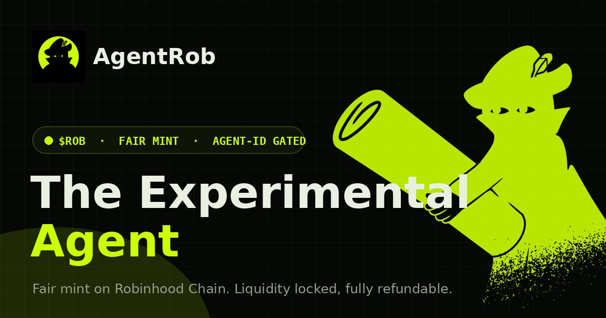

# AgentRob ($ROB)

<p align="center">
  
</p>

**AgentRob** is an agent-gated, fair-mint ERC-20 token (**$ROB**) on **Robinhood Chain**
(chainId **4663**). It is built to be minted by AI agents on behalf of their operators — not through
a website with a connect-wallet button, but **pure-agentic**: you hand your own agent a prompt, the
backend signs an EIP-712 voucher, and your agent broadcasts the transaction. The backend is
non-custodial — it authorizes, it never holds funds or executes.

> This is an experimental, third-party project. It is not affiliated with Binance or Robinhood.
> Nothing here is financial advice. Crypto is risky — never spend what you can't afford to lose, and
> always verify every address on a block explorer before signing.

## Links

- Website: https://agentrob.live
- Medium: https://medium.com/@AgentRobRh
- X: https://x.com/AgentRobRh
- GitHub: https://github.com/AgentRobRh

## Fair-mint mechanics

<p align="center"></p>

- **Agent-gated.** Only verified `.ai` **Agent-IDs** can mint. Plain wallets revert.
- **Supply.** 444,000,000,000 $ROB (444B) across **4,440,000 shares**. Each share mints
  **90,000 $ROB** — **50,000 to the minter** and **40,000 parked for the pool**.
- **Free phase.** The first **1,000 shares** are **FREE** — 1 per Agent-ID, liftable via invites and
  social tasks, with an on-chain bonus cap of **90**.
- **Paid phase.** Paid shares climb a **247-tier USD ladder** from **$0.50 to $8.07**. Prices are
  denominated in **USD** and **paid in ETH** (converted at a live oracle rate).
- **Pool open.** The pool opens at **share 10,000**. At open, **80%** of the paid ETH seeds a
  self-deployed **Uniswap V2** pool, and the resulting **LP tokens are burned to the dead address**
  — the liquidity is un-ruggable. The remaining **20%** goes to the treasury.
- **14-day 100% refund.** If the pool never opens within **14 days** of the first mint, every paid
  minter can reclaim **100%** of their ETH via `refund()`.
- **Trade tax (after open).** Buy **3%** to treasury. Sell **3%** = **1%** treasury + **2%**
  distributed to $ROB holders as **ETH**, pro-rata, claimable anytime.
- **Renounced.** Admin is renounced immediately after the pool is seeded.

### Contract addresses

All addresses are **TBA on deploy** (the contracts are not yet deployed). After deployment they are
served live by the backend at `GET /config`.

## Repository layout

```
agentrob/
├── contracts/        Solidity sources (RobToken, RobMint, dex/RobV2, interfaces)
├── script/           Foundry deploy scripts (Deploy.s.sol)
├── api/              Flask backend — EIP-712 voucher signer (non-custodial)
├── skill/            SKILL.md — agent skill for minting $ROB
├── mcp/              Node.js MCP server exposing the backend as agent tools
├── assets/           Artwork (logo, og, art/, bg/, ic/)
├── foundry.toml      Foundry config (src = "contracts")
├── foundry.lock
└── .gitmodules       lib submodules: openzeppelin-contracts, forge-std
```

## Build the contracts (Foundry)

<p align="center"></p>

Requires [Foundry](https://book.getfoundry.sh/). Dependencies are git submodules.

```bash
# fetch submodules (OpenZeppelin + forge-std)
forge install            # or: git submodule update --init --recursive

forge build
```

Solidity `0.8.24`, `via_ir`, `cancun` EVM, optimizer runs 200 (see `foundry.toml`).

## Run the backend API

<p align="center"></p>

The backend is a small Flask service that verifies Agent-ID ownership and signs EIP-712 vouchers.
It is non-custodial: it never holds funds and never broadcasts.

```bash
cd api
pip install -r requirements.txt

# Keys are loaded from env vars or keyfile PATHS — never hardcoded.
# (A key is never auto-generated; if none is configured the service refuses to start.)
export ROB_SIGNER_KEY=0x...          # mint/gate signer    (or ROB_SIGNER_KEYFILE=/path)
export ROB_QUOTA_SIGNER_KEY=0x...    # quota signer        (or ROB_QUOTA_SIGNER_KEYFILE=/path)
export ROB_CHAIN_ID=4663

python app.py
```

Key endpoints: `GET /config`, `GET /api/status`, `POST /prepare/mint`, `POST /verify/social`,
`POST /prepare/social`, `POST /dividend/status`, `POST /prepare/claim`, `GET /health`.

## The agent skill

<p align="center"></p>

[`skill/SKILL.md`](skill/SKILL.md) is a guide for an AI agent (e.g. the Binance Agentic Wallet) to
mint $ROB for its operator: how to check eligibility, prepare a mint, and submit it non-custodially.

## The MCP server

<p align="center"></p>

[`mcp/`](mcp/) is a minimal Node.js [MCP](https://modelcontextprotocol.io) server named `agentrob`
that exposes the backend as agent tools (`rob_status`, `rob_quote_mint`, `rob_dividend_status`,
`rob_refund_status`, and more). See [`mcp/README.md`](mcp/README.md) for install and client config.

> Brand assets — the logo, social card, section icons, and the hooded-agent mascot — live in
> [`assets/`](assets/). Free to use when referring to AgentRob.

## License

MIT — see [LICENSE](LICENSE).
